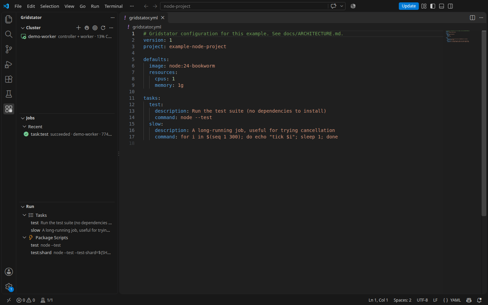

# Gridstator

**Multiple machines. One workflow.** Gridstator runs builds, tests, Docker image builds and supported GitHub Actions jobs on computers you control. It snapshots the saved working tree, including uncommitted edits, sends only missing content to a worker, and streams logs and results back to the CLI or VS Code.

> **Release status:** the Rust v2 CLI/controller/worker and native VS Code extension are development previews. The [v2 acceptance ledger](native/contracts/parity-ledger.json) still has open platform, service and signing gates. No public v2 package or Marketplace listing exists yet. The [v0.1.0 release](https://github.com/jepsenphil/gridstator/releases/tag/v0.1.0) is the legacy Node implementation; its [guides](docs/legacy/v1/README.md) remain available for recovery. The v2 CLI will be distributed as verified native binaries, not through npm.

## See it

The Gridstator view shows workers, jobs and runnable tasks beside your project. The dashboard adds capacity, logs and results. [More screenshots and capture notes](docs/SCREENSHOTS.md).

## How it works

1. A **client** on the workspace host captures the files saved on disk. With Remote SSH or WSL, this is the remote workspace host.
2. The **controller** authenticates the client, stores a content-addressed snapshot, queues the job and selects a worker.
3. A **worker** connects outbound to the controller, fetches missing content and runs the job with Docker, BuildKit or `act`.
4. Logs, structured steps, artifacts and JUnit results return to the client. VS Code can also show errors in Problems and results in Testing.

The native CLI, controller and worker are one Rust executable. The thin extension uses VS Code's supplied Node runtime for its UI and delegates workspace operations to the native executable. [Architecture and trust boundaries](docs/ARCHITECTURE.md).

## Try the v2 development preview

The release installer is intentionally unavailable until the acceptance gates pass. For an isolated source build, install the pinned Rust toolchain, a C compiler and Docker, then run:

~~~sh
cd native
export GRIDSTATOR_CONFIG="$PWD/../.gridstator-dev/client.json"
export GRIDSTATOR_CONTROLLER_DATA="$PWD/../.gridstator-dev/controller"
export GRIDSTATOR_AGENT_DATA="$PWD/../.gridstator-dev/agent"
cargo build --locked
./target/debug/gridstator controller init --host 127.0.0.1 --port 17431
./target/debug/gridstator controller start --with-agent
~~~

In another terminal, export the same `GRIDSTATOR_CONFIG` path, then from a project directory run `/path/to/gridstator nodes` and `/path/to/gridstator run -- npm test`. Choose an unused port if 17431 is occupied. The init command creates a fresh v2 cluster and saves a local login. The worker needs access to Docker. Do not point a v2 process at v1 data or credentials. [Development setup](docs/DEVELOPMENT.md) and [installation/release procedure](docs/INSTALL.md) cover other hosts and the verified distribution.

## Capabilities

- **Exact workspace runs:** tracked, untracked and edited files are captured; ignored secret files are excluded by default. Unsaved editor buffers must be saved before a run.
- **Placement and lifecycle:** schedule by capacity, resources and labels; reserve CPU/RAM for the host; drain or disable workers; cancel, retry and inspect persistent history.
- **Builds and workflows:** run commands, BuildKit image builds, supported GitHub Actions jobs through `act`, and test shards across workers.
- **Editor experience:** launch jobs from VS Code, follow logs, download artifacts, view JUnit results and manage workers. The extension supports Remote SSH and WSL workspace hosts.
- **Security model:** pinned cluster CA, TLS, scoped and revocable tokens, outbound worker connections and bounded containers. Gridstator is intended for a trusted personal or small-team network. [Security guide](docs/SECURITY.md).

## Documentation

| Guide | What it covers |
| --- | --- |
| [Install](docs/INSTALL.md) | Native artifacts, first cluster, workers and VS Code |
| [Architecture](docs/ARCHITECTURE.md) | Components, job flow, storage and trust boundaries |
| [VS Code](apps/vscode/README.md) | Run view, dashboard, secrets and remote windows |
| [Screenshots](docs/SCREENSHOTS.md) | Product captures and reproducible fixtures |
| [Security](docs/SECURITY.md) | Threat model, credentials and reporting |
| [Development](docs/DEVELOPMENT.md) | Build, test, CI and project tasks |
| [Release readiness](docs/RELEASING.md) | Gates, artifacts, Marketplace setup and owner actions |
| [Legacy v1](docs/legacy/v1/README.md) | Node release, migration and recovery |

The [desktop companion](apps/desktop/README.md) is a separate development preview. Its platform qualification and publication follow a later release.

## Contributing

See [CONTRIBUTING.md](CONTRIBUTING.md). Vulnerabilities should be reported through the [private security advisory form](https://github.com/jepsenphil/gridstator/security/advisories/new).

Apache-2.0; see [LICENSE](LICENSE).
