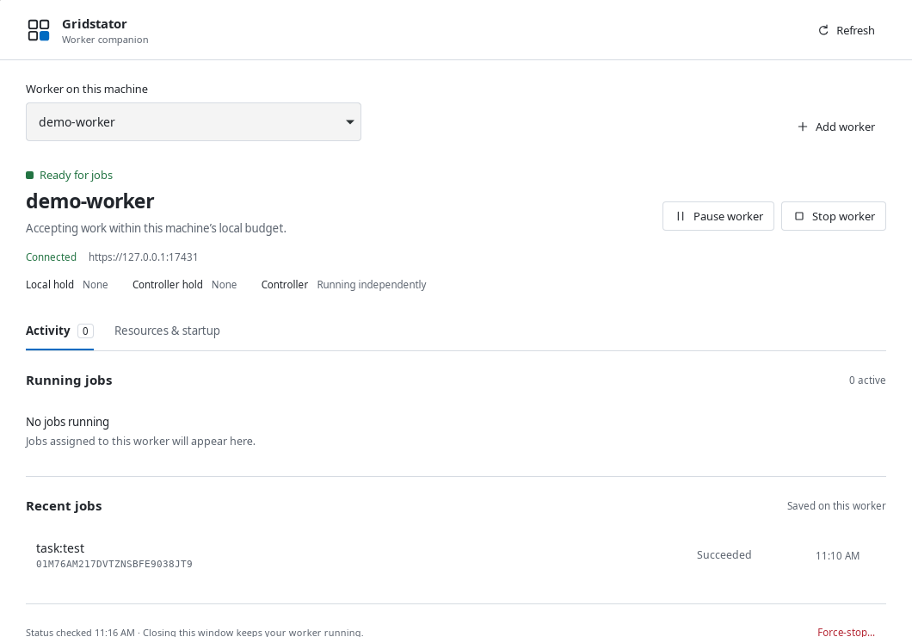

# Gridstator desktop companion

The desktop companion provides a tray/menu-bar icon and a worker window for this account's local
Gridstator workers. It shows connection state, active/recent jobs and logs, and provides persistent
Pause, resource admission budgets, graceful Stop, confirmed force-stop, cancellation and startup
settings. Closing the window or quitting the companion leaves workers running.

Windows uses a native companion with account-specific WSL2 worker registrations. Setup offers a
choice of existing WSL2 distributions, then Join a controller or Create a controller here. Linux and
macOS use their native Gridstator CLI. CLI/server installations remain headless.

This is an unsigned development preview. Actual macOS and Windows sign-in, tray and WSL lifecycle
qualification remains outstanding. See [implementation evidence](../../docs/DESKTOP_COMPANION_PROGRESS.md)
and the [acceptance plan](../../docs/DESKTOP_COMPANION_PLAN.md).



The image is a real Linux debug window against a disposable cluster. [More captures and fixture
labels](../../docs/SCREENSHOTS.md) keep it separate from platform release evidence.

## Installers

The companion is distributed as an installer for each desktop OS. Portable executables and ZIPs
are supplementary developer artifacts.

| OS | Installer | Install experience |
| --- | --- | --- |
| Windows | `Gridstator_<version>_<arch>-setup.exe` | Per-user setup wizard, Start menu shortcut, WebView2 installation when missing and an entry in Installed apps for uninstall. |
| macOS | `Gridstator_<version>_<arch>.dmg` | Open the disk image, drag Gridstator to Applications, then launch it. |
| Ubuntu/Debian Linux | `Gridstator_<version>_<arch>.deb` | Open with the system's package installer, or run `sudo apt install ./Gridstator_<version>_<arch>.deb`. Dependencies and application launcher are installed by the package manager. |

After installation, launch Gridstator and choose Join a controller or Create a controller here.
Windows setup selects an existing WSL2 distribution and guides missing prerequisites; the setup
wizard installs the native companion. Worker/controller setup takes place inside the chosen WSL2
distribution. Companion and worker sign-in preferences remain separate.

Updates replace the companion without reinstalling native workers or erasing their data. On
Windows, an in-place update reattaches the configured background host without applying sign-in
startup again. Uninstall removes this installation's host login entry; worker/controller services,
WSL distributions and their data are retained. Actual OS upgrade/uninstall qualification remains
part of the release checks.

macOS uses the standard [DMG installation window](https://v2.tauri.app/distribute/dmg/).
Windows uses Tauri's [NSIS setup installer](https://v2.tauri.app/distribute/windows-installer/).

## Build and run

Use the repository's pinned pnpm and Rust toolchains. Install the official Tauri 2 prerequisites for
your host; Linux builds need WebKitGTK 4.1 and Ayatana AppIndicator development libraries. Node and
Rust are build dependencies; installed desktop and worker executables do not need Node.

```sh
pnpm install --frozen-lockfile
pnpm desktop:dev
pnpm desktop:installer
```

`desktop:installer` (also `desktop:build`) selects NSIS on Windows, DMG on macOS and Debian on
Linux through the platform Tauri configuration. Build each platform on its matching host. Output
is copied to the repository root at `distro/<version>/`, with a checksum manifest per OS and
architecture. For example, `distro/2.0.0-dev.1/` contains the current Windows setup executable and
Linux Debian package. New builds update their own files there while keeping other platforms and
versions. The folder is generated and ignored by Git.

Original bundles also remain under `apps/desktop/src-tauri/target/release/bundle/`; an explicit Rust
target adds its target triple before `release/`. CI requires a matching installer, exports the same
versioned distro layout and records its checksum; a raw app or portable ZIP does not satisfy that
check. To copy an existing bundle without rebuilding:

```sh
node scripts/desktop-artifacts.mjs distro \
  --manifest apps/desktop/src-tauri/target/debug/bundle/installer-manifest.json
```

On Linux, to build a Debian development package:

```sh
pnpm desktop:resources
pnpm --filter @gridstator/desktop exec tauri build --debug --bundles deb
```

The native helper must advertise `bridge-v1`, `worker-control-v1` and `local-setup-v1`. The app discovers helpers in
trusted account install locations; Advanced setup can select an explicit absolute helper path on
Linux/macOS. If absent, setup uses the staged, reviewed native installer. A compatible native
release must exist before that automatic download can complete; desktop packaging does not publish
or invent a native release. For an unreleased native checkout, build `native/` and select its binary
to control existing development workers. Managed service creation still requires a matching,
verified native release installation.

Windows installers can carry the Linux native release needed for WSL2. Setup verifies the bundled
manifest against a digest embedded in the companion, checks the archive and executable, and installs
it inside the selected distribution without contacting GitHub. It retains the verified manifest for
background service creation. WSL2 and a configured Linux account are still prerequisites.

```sh
pnpm desktop:installer --target x86_64-pc-windows-msvc \
  --native-release-dir /absolute/path/to/compatible-native-release \
  --native-manifest-sha256 TRUSTED_MANIFEST_SHA256
```

The release directory must contain the complete four-target `gridstator-release.json` and the
matching Linux archive. Use a release built from sources with all three required capabilities;
older v2 previews cannot support desktop setup. `--native-target linux/amd64,linux/arm64` bundles both
WSL architectures. `GRIDSTATOR_NATIVE_RELEASE_DIR` and `GRIDSTATOR_NATIVE_MANIFEST_SHA256` provide
the same inputs through the environment. `desktop:installer` preserves a previously staged bundle;
`desktop:resources` explicitly resets generated resources when no release is supplied. Windows
installer builds reject an absent bundle unless a published native tag is explicitly pinned.

To package an already verified native release alongside Linux/macOS builds, stage it explicitly:

```sh
node scripts/desktop-artifacts.mjs stage \
  --native-cli /absolute/path/gridstator \
  --native-manifest /absolute/path/gridstator-release.json \
  --native-manifest-sha256 TRUSTED_MANIFEST_SHA256 \
  --native-target linux/amd64
pnpm --filter @gridstator/desktop exec tauri build --bundles deb
```

Staging checks the complete four-target core manifest, executable architecture, size and checksum.
The desktop manifest is separate; no Windows executable is added to the core release manifest.
Running `desktop:resources` without helper arguments removes any previously staged optional helper.
`GRIDSTATOR_NATIVE_INSTALL_TAG=v2.x.y` pins installer staging to a compatible native release.

## Behavior and boundaries

Windows host routing identifies both the installation path and executable contents. An old portable
preview or a host left running through an update cannot receive a different build's requests.
The `2.0.0-dev.2` companion includes this fix. Earlier builds shared one host endpoint per account:
an installed app could consequently use a Downloads preview's host and report a missing native
release despite containing a verified offline bundle. Quitting the companion from the tray and
stopping that specific legacy `--worker-host` process clears the old routing until the update is
installed. Native worker/controller services are independent of the companion host.

Pause persists across restarts and reboots. It prevents new admissions; assignments already accepted
may finish. Resource controls constrain accepted workload and concurrency, with existing per-job
limits; they do not promise a machine-wide CPU/memory cap. Local limits continue to apply while
disconnected, and controller settings cannot increase them.

Stop drains accepted jobs without a fixed timeout, then stops only the worker. An embedded
controller remains available. A separate confirmed force-stop cancels running work. Per-worker
sign-in preferences are independent of the companion's own sign-in checkbox. A persistent Pause
survives either startup path. Opening or refreshing the window does not start manually stopped
workers.

The GUI uses a narrow Tauri command interface, without general shell or filesystem plugins. Native
control uses owned local sockets; Windows routing pins WSL registration, account and worker
identity. Join credentials use private stdin and are not stored in desktop preferences.

## Validation

```sh
pnpm desktop:typecheck
pnpm desktop:test:packaging
pnpm desktop:test:ui
cargo test --manifest-path apps/desktop/src-tauri/Cargo.toml --no-default-features
cargo clippy --manifest-path apps/desktop/src-tauri/Cargo.toml --all-targets -- -D warnings
```

Browser tests mock only the IPC boundary and cover controls, errors, polling races, setup and narrow
layouts. Real native worker tests live in `native/tests/local_worker_contract.rs` and the native
worker runtime suite. Browser screenshots are written to `test/screenshots/`.

On Windows, `cargo test --manifest-path apps/desktop/src-tauri/Cargo.toml --test windows_subsystem`
checks that the compiled debug executable uses the GUI subsystem so launching it does not open a
terminal. Windows CI runs this check for both architectures; debug and release builds use the same
GUI subsystem setting.

For isolated native GUI checks, set absolute `GRIDSTATOR_DESKTOP_CONFIG` and temporary native data
paths. `GRIDSTATOR_DESKTOP_TEST_MODE=1` suppresses OS sign-in registration and startup actions;
it does not replace real worker control with fixtures. `--build-info --json` reports desktop build
identity without starting GTK/WebView. CI builds preview packages on each native target and records
signing/lifecycle qualification separately.
