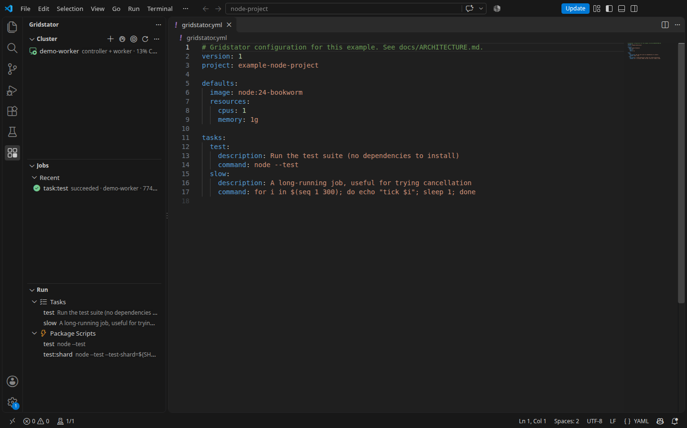
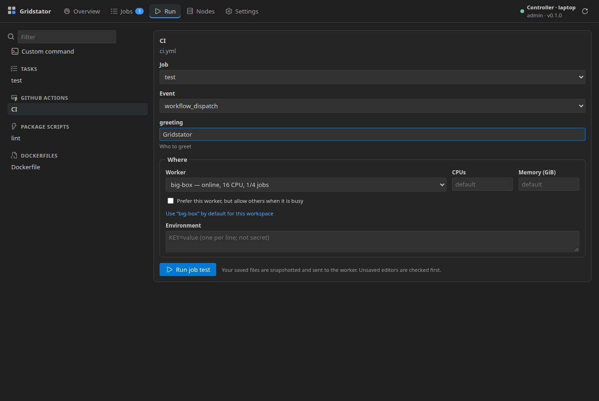

# Gridstator for VS Code

**Native v2 development preview.** This extension runs build, test and supported workflow jobs on your Gridstator cluster from the workspace where your files live. The first public listing is planned as `gridstator.gridstator`. Until the [release gates](https://github.com/jepsenphil/gridstator/blob/main/docs/RELEASING.md) pass, build the native VSIX from source; no Marketplace package is live.

## What you can do

- Open **Run** to find `gridstator.yml` tasks, package scripts, Dockerfiles and supported GitHub Actions workflows. An optional `actions.launcher` allowlist in project config can narrow workflow/job choices in the editor.
- Choose a worker or let the scheduler place the job, then follow live logs and structured steps.
- See recent jobs, artifacts, image results and worker capacity in the dashboard; cancel, retry or rerun jobs.
- Map compiler and test failures to **Problems**, and JUnit artifacts to **Testing**.
- Manage workers, reservations, concurrency and access from the Cluster view and Settings.

## Start

1. Install a verified native CLI on the **workspace host** using the [install guide](https://github.com/jepsenphil/gridstator/blob/main/docs/INSTALL.md). In Remote SSH and WSL windows, that is the remote machine, not the desktop running VS Code.
2. Build a development VSIX with `pnpm --filter ./apps/vscode package:native`, then install `apps/vscode/dist/gridstator-native.vsix` through **Extensions: Install from VSIX**. The public extension will be available from the Marketplace after release.
3. Open a trusted project folder and the Gridstator Activity Bar. Choose **Set up a controller here** or **Connect to an existing controller**. Local setup uses a verified published native release; until one exists, install the CLI manually and set `gridstator.nativeCli.path` if needed.
4. Select a task, script, Dockerfile or workflow in **Run**. Jobs use files saved on disk; the extension asks about unsaved editors before submission.

The native VSIX delegates discovery, snapshot capture, submission and local administration to Rust. It uses a separate native v2 login and does not bundle the legacy Node CLI. VS Code supplies the extension's Node runtime.

## Secrets and remote workspaces

Declare only **names** in `secretEnv` on a task, build or Actions config. The extension reads corresponding values from the extension-host environment. In a trusted workspace it asks for missing values with masked prompts and saves them in VS Code SecretStorage, scoped to that workspace host, account and project path. The host environment takes precedence. Saved values do not sync between machines; **Gridstator: Clear Saved Job Secrets** removes selected values. Do not put secret values in the plain Environment field.

Workers connect outbound to the controller. A Remote SSH or WSL VS Code window captures and submits the workspace on its remote host. Install the native helper and sign in there. Local desktop companion controls are [separate preview functionality](https://github.com/jepsenphil/gridstator/blob/main/apps/desktop/README.md).

## More

See the [screenshots and capture notes](https://github.com/jepsenphil/gridstator/blob/main/docs/SCREENSHOTS.md), [architecture](https://github.com/jepsenphil/gridstator/blob/main/docs/ARCHITECTURE.md), [security model](https://github.com/jepsenphil/gridstator/blob/main/docs/SECURITY.md) and [development guide](https://github.com/jepsenphil/gridstator/blob/main/docs/DEVELOPMENT.md). File bugs in the [repository](https://github.com/jepsenphil/gridstator/issues) and report vulnerabilities privately through [GitHub advisories](https://github.com/jepsenphil/gridstator/security/advisories/new).
