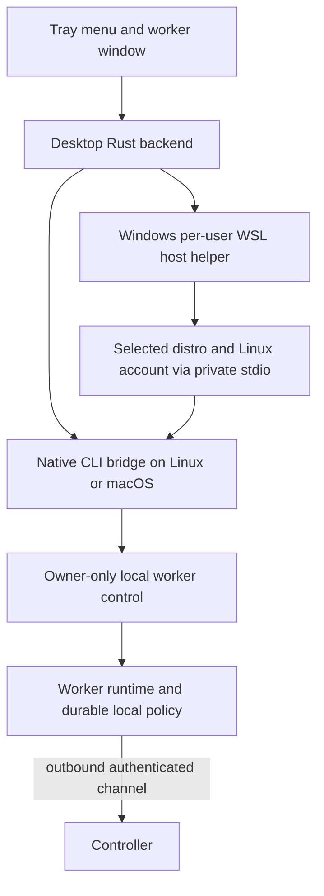

# Gridstator desktop companion implementation plan

Date: 2026-11-10. Status: product design confirmed in Q17; implementation authorized by the
subsequent “build” request. See [implementation progress](DESKTOP_COMPANION_PROGRESS.md) for
completed checks and platform qualification.

## 1. Outcome and scope

Give the person using a worker machine a desktop icon for seeing and controlling its Gridstator
worker without opening VS Code or logging in as a cluster administrator. Desktop installations
include a companion that starts at OS sign-in. CLI/server installations remain headless and keep
their existing runtime requirements.

Windows gets a native tray application that controls Linux workers in user-selected WSL2
distributions. macOS gets a menu-bar application; Linux gets desktop integration and a worker
window that remains usable when a tray is unavailable. One icon represents the signed-in OS user;
on Windows it lists that user's configured WSL workers by distribution.

The original request authorized planning; the subsequent build request authorizes implementation.
It does not authorize changing an existing production cluster or publishing a release. The
[native upgrade plan](V2_UPGRADE_PLAN.md) and [release gates](../native/RELEASING.md) remain in force.
The companion extends their scope with a Windows GUI and local worker controls, while retaining
the existing Linux/macOS worker execution model.

### Confirmed decisions

| ID | Decision |
| --- | --- |
| Q1 | Focus on this machine's worker: status, running jobs, pause/resume, resources and logs. |
| Q2 | Native Windows tray application controlling WSL2 workers; no native Windows worker. |
| Q3 | Include the companion in desktop installs and start it at sign-in; CLI/server installs remain headless. |
| Q4 | The worker enforces local pause and resource limits, including offline; the controller cannot raise those limits. |
| Q5 | One icon per signed-in Windows user, listing configured WSL workers by distribution. |
| Q6 | Pause immediately blocks new jobs and lets existing jobs finish; cancellation is a separate action. |
| Q7 | Quit closes the companion only; the worker keeps running. |
| Q8 | Per-worker startup preference; desktop setup defaults it to automatic start. |
| Q9 | Pause persists until explicitly resumed, including across worker/app restarts and reboots. |
| Q10 | Resource controls limit accepted workload and concurrency, with existing per-job enforcement; no strict combined CPU/RAM usage guarantee. |
| Q11 | Stopping a worker leaves a co-located controller and other machines' jobs running. |
| Q12 | Stop drains current jobs without an implicit deadline; separately confirmed force-stop cancels them. |
| Q13 | Clicking the icon opens a compact status/actions menu; Open worker window exposes jobs, logs and settings. |
| Q14 | Desktop onboarding offers both Join a controller and Create a controller here. |
| Q15 | Windows uses an explicitly selected existing WSL2 distribution; guide installation if none is available. |
| Q16 | After a manual Stop, the next OS sign-in follows the worker's startup preference; persistent Pause remains effective. |
| Q17 | Confirm the design and write this implementation plan with acceptance checks for each OS. |

### Boundaries

- Controller creation is an onboarding operation, not a full cluster administration dashboard.
- No native Windows execution backend, managed WSL distribution, automatic distro conversion, or
  automatic Docker installation. Missing prerequisites produce a clear next step.
- No changes to job submission, snapshots, container isolation, or remote-controller trust rules.
- A local admission budget is not a strict combined usage cap, including across WSL distributions
  sharing host resources. Lowering a budget affects new assignments; existing jobs may exceed the
  new budget until they finish.
- Desktop applications may have GUI/webview dependencies. They must not introduce GUI dependencies
  into the standalone CLI, controller, worker, or headless installer.

## 2. Current code and required changes

| Existing implementation | Reuse or change |
| --- | --- |
| [worker.rs](../native/src/worker.rs): outbound controller channel, active assignments, durable logs/results and shutdown | Add durable local policy, worker-side admission checks and local control. Preserve outbound-only network behavior. |
| [controller.rs](../native/src/controller.rs): `start_embedded` stops its server when the worker task exits | Supervise the worker independently so Stop/Start does not restart the controller or change worker identity. |
| [scheduler.rs](../native/src/scheduler.rs): requested CPU/memory, reservations and concurrency | Schedule against effective local capacity and explain local holds. The worker remains the final admission check. |
| [services.rs](../native/src/services.rs): systemd/launchd adapters, ownership and a default 90-second stop timeout | Reuse ownership/startup controls. Do not initiate an indefinite graceful drain using an immediate service-manager Stop. |
| [cli.rs](../native/src/cli.rs) and [bridge.rs](../native/src/bridge.rs): private stdin requests and verified local setup | Add versioned worker operations; reuse controller setup, token handling and interrupted-setup recovery. |
| [install.rs](../native/src/install.rs), [release.rs](../native/src/release.rs), [updates.rs](../native/src/updates.rs) | Preserve verified payloads, native update/rollback and compatibility checks. Desktop artifacts need a separate manifest. |
| [VS Code onboarding](../apps/vscode/src/setup.ts), [connection parser](../apps/vscode/src/sign-in.ts), [dashboard components](../apps/vscode/webview/components) | Reuse behavior and selected presentational components. Do not import the VS Code host API or expose its entire dashboard in the desktop app. |

The current resource scheduler is controller-owned, and the worker has no general desktop control
endpoint. This feature therefore needs a local control boundary and worker enforcement; wrapping
the existing controller dashboard is insufficient.

## 3. Proposed implementation architecture

These are engineering recommendations for implementation, distinct from the confirmed product
decisions above. D0 qualifies dependency versions, platform baselines and packaging before adopting
them.

### Desktop shell and shared contracts

Use a separate Tauri 2 desktop application with a Rust backend and a small React/TypeScript worker
window. It fits the current Rust core and React UI while providing a tray, singleton handling and
desktop startup integration. Package UI assets locally and allow only narrow typed commands;
the webview receives neither shell execution nor unrestricted filesystem/network access.
See Tauri's [tray](https://v2.tauri.app/learn/system-tray/),
[single-instance](https://v2.tauri.app/plugin/single-instance/),
[autostart](https://v2.tauri.app/plugin/autostart/) and
[capability](https://v2.tauri.app/security/capabilities/) documentation.

Keep the Windows shell independent of the Unix-oriented native core crate. Share a small portable
protocol crate/schema; Windows executes the Linux helper inside WSL rather than compiling the
controller or worker into its GUI. Pin desktop dependencies and their Rust minimum separately;
do not silently raise the standalone core's minimum or bundle Node as a runtime.

### Local control and authority

Add a private, versioned worker-control protocol, advertised by a capability such as
`worker-control-v1`. The native CLI is the entry point for both the companion and future CLI
controls; it validates targets and communicates with the live worker through a Unix-domain socket
in an account-private runtime directory. Service start/status also work when the worker is stopped.
Windows uses a user-restricted named pipe to its host helper and private WSL stdin/stdout to the
Linux bridge. No worker HTTP listener or LAN administration endpoint is introduced.

Identify each target by the local account, worker data directory, node ID and cluster ID; on
Windows also record the WSL registration and Linux account. Names are display labels. Validate
ownership and identity before mutation; reject foreign/system-account services rather than
silently elevating. Local worker control needs no reusable cluster admin token.

Initial operations: list/status, watch status, pause/resume, set local budget, start, graceful stop,
force-stop, cancel a local running job, read bounded local logs, and read/write startup preference.
Use explicit schemas, protocol negotiation, request IDs and policy generations. Serialize local
mutations and atomically persist policy before acknowledging it. Validate peer identity, reject
symlink/path substitution, bound requests and log reads, and preserve secret masking.

Persist `paused` and the local CPU/memory/concurrency budget independently of controller settings.
Report controller-requested settings, local limits and effective settings separately. Effective
capacity is the smaller of controller-allowed and locally allowed capacity; either side can block
new work. The controller cannot clear local Pause, increase a local limit or start a locally
stopped worker. Local Resume clears only the local hold, not a controller hold.

Enforce admission atomically in the worker, counting accepted starting and running assignments.
Assignments accepted before a Pause acknowledgement are active work and may finish, including
their startup; no assignment is accepted after that acknowledgement. Recheck stop/cancellation
before launching execution, without cancelling accepted work merely because a budget was lowered.
Advertise effective capacity and a policy generation to the controller; handle stale
assignments without repeated redispatch loops. Older controllers cannot bypass worker checks;
unsupported UI/protocol combinations must report the incompatibility explicitly.

### Worker and controller lifecycles

Use distinct states for service stopped, waiting for prerequisites, disconnected, accepting work,
paused, draining to stop and update/restart pending. Connection state and local intent are separate:
a disconnected worker can still be locally paused or draining.

Graceful Stop is a worker operation: block admissions, finish active execution, preserve durable
logs/results, then stop the owned worker service or embedded worker task. Do not send an immediate
systemd/launchd stop signal and rely on its timeout to drain. An unavailable controller must not
prevent stopping once active work has finished and results are durable; replay pending results on
the next start. Keep an explicit confirmed force-stop available while draining.

Refactor embedded supervision so normal worker Stop does not cancel the controller server. Start
reuses its existing node identity and saved credentials. Controller shutdown and managed updates
remain separate coordinated operations; tests must also cover update-related worker exits.

Manual Stop prevents automatic restart within the current OS sign-in session, including when the
companion is reopened. At the next sign-in, apply the startup preference. Pause is durable across
both events and must be loaded before the first admission. Prefer the OS service manager's boot or
login identity for session detection over the companion process lifetime.

### Windows and WSL lifecycle

Enumerate the current Windows user's distributions without starting them. Display stopped,
unavailable and WSL1 entries accurately; only explicitly selected WSL2 distributions are managed.
Use an argument vector to `wsl.exe` with the selected distribution/account and an executable path;
send private requests through stdin. Never run pasted commands through a shell, assume every
distro is Ubuntu, or rewrite the user's default distribution. See Microsoft's
[WSL command reference](https://learn.microsoft.com/en-us/windows/wsl/basic-commands).

Use a small per-user Windows background host helper, independent of the GUI, to apply startup
preferences, retain the required WSL bridge sessions and reconnect to running workers. Quit exits
the GUI without killing this helper or its worker sessions. Keep helper singleton ownership
separate from GUI singleton ownership so opening another window cannot duplicate a worker.

This lifecycle must be proven on Windows: Microsoft documents that systemd services alone do not
keep a WSL distribution alive. The independent host/bridge arrangement is this plan's response to
that constraint, not a guarantee supplied by systemd. Verify the selected approach during D0 and
D5. See Microsoft's [systemd announcement](https://devblogs.microsoft.com/commandline/systemd-support-is-now-available-in-wsl/).

Startup launches only configured workers whose preference is enabled; merely refreshing status
must not start a stopped distribution. Do not restart a manually stopped worker during the same
Windows sign-in. Maintain the WSL host session if an independently running controller in that
distribution still needs it after its worker stops. Never use `wsl --shutdown`, terminate a whole
distribution, or unregister it as a worker-control operation.

### Desktop experience and onboarding

The menu shows worker/distro, state, active job count, Pause/Resume, Start/Stop, Open worker window
and Quit companion. On Windows, group configured workers under one icon. Label local and
controller holds separately. The worker window shows active/recent local jobs, masked logs,
prerequisite status, local workload budgets and startup preferences. Close hides the window;
Quit closes the companion. Neither action stops a worker.

Use text and icon shape as well as color for states. Support keyboard navigation, screen readers,
light/dark modes and display scaling. Prefer actionable worker-error notifications to a popup for
every job. Linux must offer the same actions through its application window when tray integration
is missing; do not depend on custom tray mouse events, which
[Tauri does not expose on Linux](https://v2.tauri.app/learn/system-tray/).

Onboarding first detects an owned standalone or embedded worker. Otherwise offer:

1. **Join a controller:** paste and validate a worker join command, verify the pinned CA, register
   the worker and configure its service/startup preference. Keep a manual-entry fallback. A worker
   join token is distinct from a client login token; never accept one as the other.
2. **Create a controller here:** reuse the verified native setup and shared local login behavior,
   including resumable installation, port-conflict handling and a local worker. On Windows, this
   happens in the selected WSL2 distribution. The controller stays independent of companion exit
   and local worker Stop.

Missing Docker leaves the worker waiting, without blocking controller creation. Guide WSL/systemd
prerequisite setup when necessary and resume after user-performed installation/restart. Do not
silently restart WSL, install Docker or modify a foreign saved connection.

## 4. Proposed code ownership

| Location | Responsibility |
| --- | --- |
| `apps/desktop/` | Desktop build, React worker window, Rust tray/backend, OS installers and UI tests. |
| `native/local-control-protocol/` | Portable Rust request/status types plus the schema used for TypeScript contracts; no GUI or Unix runtime dependencies. |
| `native/src/worker/policy.rs` | Durable local intent, budget validation and effective admission decisions. |
| `native/src/worker/control.rs` and `native/src/local_worker.rs` | Owner-only live control, stopped-service operations, registry and status/log access. |
| `native/src/worker.rs`, `controller.rs`, `scheduler.rs`, `protocol.rs` | Worker enforcement, independent embedded lifecycle and controller visibility. |
| `native/src/bridge.rs`, `cli.rs`, `services.rs`, `updates.rs` | Versioned entry points, startup/session handling, graceful stop and update integration. |
| `apps/desktop/src-tauri/` or a separate small portable host crate | Windows WSL registry/bridge and independent background host helper. |
| Desktop workflow and manifest alongside existing native workflows | Desktop artifact identity, signing, checksums and platform evidence without adding Windows core-worker artifacts. |

Extract only UI components actually reused by the worker window. Keep desktop design tokens
independent of VS Code's injected theme variables. Avoid a general dashboard refactor as a
prerequisite.

## 5. Milestones and dependencies

| Milestone | Work | Exit evidence |
| --- | --- | --- |
| D0: platform qualification | Pin desktop stack/MSRV; define OS/architecture baselines and installer formats; prove tray/window singleton, WSL lifecycle and service/session semantics. | Actual-host spike on each OS, including WSL worker survival after GUI exit; record dependencies and blockers. |
| D1: local policy | Durable pause/budgets; worker admission enforcement; controller effective-state reporting; policy-race handling. | Pure policy tests plus real controller/worker cases for offline changes, restart and competing settings. |
| D2: local control boundary | Typed bridge/IPC, ownership checks, stopped-service status/start, bounded local jobs/logs and event delivery. | Same-account success, foreign-account denial, stale identity/path rejection and no credential leakage. |
| D3: independent lifecycle | Graceful/forced Stop, durable results without controller ACK, startup/session policy and embedded worker Start/Stop. | Long-running job survives drain beyond the existing stop timeout; controller PID/API and remote work remain intact. |
| D4: desktop shell and onboarding | Menu/window, settings, singleton, autostart, detect/join/create and prerequisite/retry states. | UI interaction/accessibility captures plus real installer-to-first-worker flow. |
| D5: Windows WSL integration | Distro/account selection, independent host helper, multiple-worker routing and login startup. | Actual Windows/WSL multi-distro, no-terminal, GUI-exit, reboot and force-stop evidence. |
| D6: distribution and release rehearsal | Compatible desktop/native versions, signed installers, headless isolation, upgrades/uninstall and per-OS acceptance matrix. | Final downloaded artifacts pass all applicable checks below; receipts identify exact bytes. |

D0 precedes platform-dependent implementation. D1 precedes D2/D3 enforcement integration; D2 and
D3 precede live D4 controls. D4's visual shell can be developed against contract fixtures while
native work proceeds. D5 depends on the D0 WSL proof and D2/D3; D6 needs all earlier milestones.
No milestone is complete because its code compiles or because a service-manager stub passes.

## 6. Acceptance checks

### Shared behavior, on every supported desktop OS

| ID | Scenario and required result |
| --- | --- |
| C01 | Install/open twice: one icon for the signed-in user; an existing owned worker is detected without cluster admin login. |
| C02 | Join with valid/invalid/expired tokens and CA pins: valid join reaches ready/waiting state; failures reveal no secrets and replace no existing registration. |
| C03 | Create controller: verified install, resumable cancellation/failure, local worker and automatic local login; missing Docker shows waiting. |
| C04 | Pause during an assignment/startup race: no assignment is admitted after the acknowledged pause; previously accepted starting/running jobs may finish. Offline Pause survives worker/app restart and reboot. |
| C05 | Change local budgets while offline and with active work: no new over-budget assignment; current work finishes; controller changes cannot relax local policy. |
| C06 | Resume while the controller has its own hold: clear only the local hold and display the remaining reason. |
| C07 | Graceful Stop with a job running longer than 90 seconds: job completes, results/logs remain durable, worker stops; no implicit cancellation. Repeat with controller disconnected. |
| C08 | Confirm force-stop and cancel a local job: only selected worker/job resources are affected; unrelated Docker objects and other workers remain intact. |
| C09 | Quit/reopen/crash the companion: worker continues, policy survives and reopening attaches without duplication. Stop/reopen does not auto-start within the same OS session. |
| C10 | Restart/sign-in with startup enabled/disabled and paused/unpaused: preference is applied; Pause remains until explicit Resume. |
| C11 | Stop/Start an embedded worker: controller PID, listener, cluster/node identity and other machines' jobs remain stable. Verify update-related exits retain their existing coordinated maintenance behavior rather than being treated as manual Stop. |
| C12 | Controller unavailable: local status, pause, limits, cancellation and stop remain usable; logs are masked and stale/unknown state is labeled. |
| C13 | Foreign account, forged IPC target, stale PID/socket, malicious paths or version mismatch: reject safely; no elevation, remote listener or arbitrary command execution. |
| C14 | Upgrade/relaunch the GUI while jobs run: jobs continue; compatible helper reconnection works, incompatible operations are disabled with a recovery path. Uninstalling the GUI does not silently remove worker/controller data or services. |

### Windows and WSL

- **W01:** Install the native Windows package, including WebView2 handling; no native Windows
  controller/worker is installed. Validate on the advertised Windows architectures.
- **W02:** No WSL, WSL1 only, missing systemd, no distro, stopped distro and unavailable Docker:
  show accurate guided/retry states without converting, deleting or restarting distributions.
- **W03:** Two configured WSL2 distributions: one icon, correct identity/account routing, independent
  pause, budgets, logs and startup settings. An unconfigured distro is never started by discovery.
- **W04:** Sign out/in and reboot with no terminal or VS Code open: only opted-in workers start;
  durable Pause remains active. Manually stopped workers obey Q16 at the next sign-in.
- **W05:** Close every terminal and Quit the companion during a long job: worker and any controller
  remain available through the independent host/bridge lifecycle. Reopen and reattach.
- **W06:** Stop one worker without terminating its distro, controller, other worker or unrelated WSL
  process. Explicit external WSL shutdown is reported as unavailable, not mistaken for Pause.
- **W07:** Distro/account rename or removal, localized/non-ASCII output and paths with spaces:
  no mistaken identity or shell interpretation. Another Windows user cannot control these workers.
- **W08:** Upgrade/uninstall the companion: retain selected WSL distributions and worker/controller
  state. Explain any separately retained background host; never unregister a distro.

Microsoft's WSL service/lifecycle behavior must be tested on a real Windows host. A Linux test
process with a fake `wsl.exe` is transport-test evidence only.

### macOS

- **M01:** Test Intel and Apple Silicon with actual downloaded application bundles; verify menu-bar
  icon, menu/window behavior, second launch, scaling and light/dark appearance.
- **M02:** Verify per-user login launch, worker launchd service, Quit/reopen and reboot behavior.
  GUI exit and embedded worker Stop must leave the controller available.
- **M03:** Start before Docker Desktop is ready, then start Docker: the same worker becomes usable
  without rejoining; host and Docker VM capacity remain distinct.
- **M04:** Run commands, builds and Actions through pause, long drain, force-stop, disconnect and
  update. Verify local admission budgets without claiming a combined VM usage cap.
- **M05:** Signed/notarized application and contained helpers pass Gatekeeper after download on both
  architectures. Signing the old standalone CLI does not qualify the new desktop bundle.

### Linux desktop and headless

- **L01:** Test advertised x64/ARM64 desktop packages on the declared baseline distributions;
  record actual GTK/WebKit/tray dependencies and distinguish these from the static core CLI.
- **L02:** Test both a tray-capable desktop and a desktop without tray integration, on the advertised
  Wayland/X11 combinations: the application launcher/window provides every worker control.
- **L03:** Verify sign-in autostart, singleton scope and systemd user-service startup. Desktop
  session exit, lingering permission denial and headless SSH access must produce truthful status.
- **L04:** Verify long drains do not hit the service-manager stop timeout. Close the GUI during work
  and stop an embedded worker while the controller serves another machine.
- **L05:** Install only the CLI/server artifacts on a machine with no display server, tray, GTK or
  WebKit packages: worker/controller operation and update continue without GUI dependencies.
- **L06:** Remove/upgrade the desktop package and reboot: autostart entries are handled correctly,
  existing headless services/data remain intact, and worker startup still follows its preference.

### Evidence and release gate

For every advertised OS/architecture, retain the OS/version, desktop or WSL version, user-service
mode, Docker readiness, artifact checksums, build IDs, protocol versions, screenshots and actual
scenario outcomes. Record failures and unavailable hosts as unverified, never as passes inferred
from cross-compilation, UI fixtures or service-manager mocks. Existing native release gates remain
required. This plan provides no new platform-validation evidence.

## 7. Packaging, updates and implementation-time qualification

Produce desktop artifacts separately from the existing four-target core manifest, which currently
rejects additional targets. Add an explicit desktop manifest containing its OS/architecture,
checksums/signatures, bundled helper identity and supported local-control versions. Windows GUI
artifacts must not be labeled as Windows worker artifacts.

Proposed target coverage is Linux x64/ARM64, macOS Intel/Apple Silicon and Windows x64/ARM64 UI
with WSL2. D0 must qualify each target and record available actual-host validation. An unavailable
target remains unverified and cannot be advertised as supported. Declare minimum OS versions and
package formats there; do not equate an OS name with support for every desktop distribution.

Prefer a signed per-user Windows installer, a signed/notarized macOS application bundle, and
Linux packages with declared desktop dependencies and an application launcher. Tauri documents
[WebView2 installation choices](https://v2.tauri.app/distribute/windows-installer/) and
[Linux package dependencies](https://v2.tauri.app/distribute/debian/); these differ from the core's
static Linux delivery. Qualify offline installation and architecture-specific artifacts rather
than assuming one installer works everywhere.

Keep worker updates under the existing native managed-update/rollback flow. Update the GUI and
Windows host helper independently with a declared compatibility range, without stopping a worker
merely to update its UI. If a required native helper update is incompatible, explain and use the
existing graceful worker-update policy. Desktop startup must not upgrade or replace an existing
executable implicitly.

Before implementation, D0 must settle the exact dependency lock, supported minimum OS versions,
Linux package formats, actual-host access and Windows signing mechanism. These are engineering
qualification tasks, not reasons to reopen the confirmed worker behavior. Stable signing
credentials and unavailable platform hardware are release dependencies; preview artifacts must
remain labeled accordingly. No public publication or production-cluster change is authorized by
this planning task.
