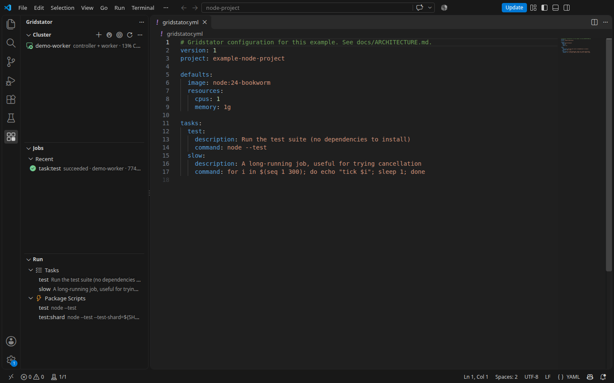
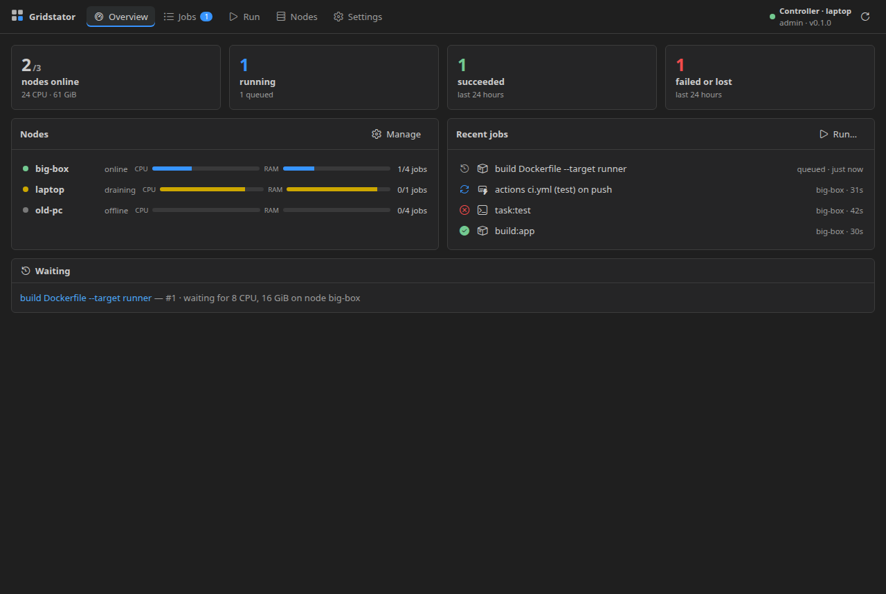
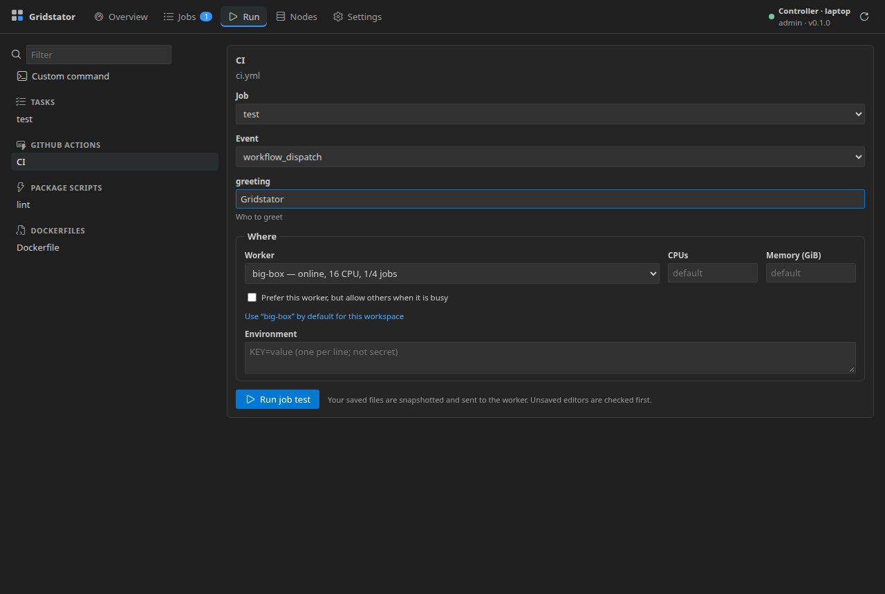
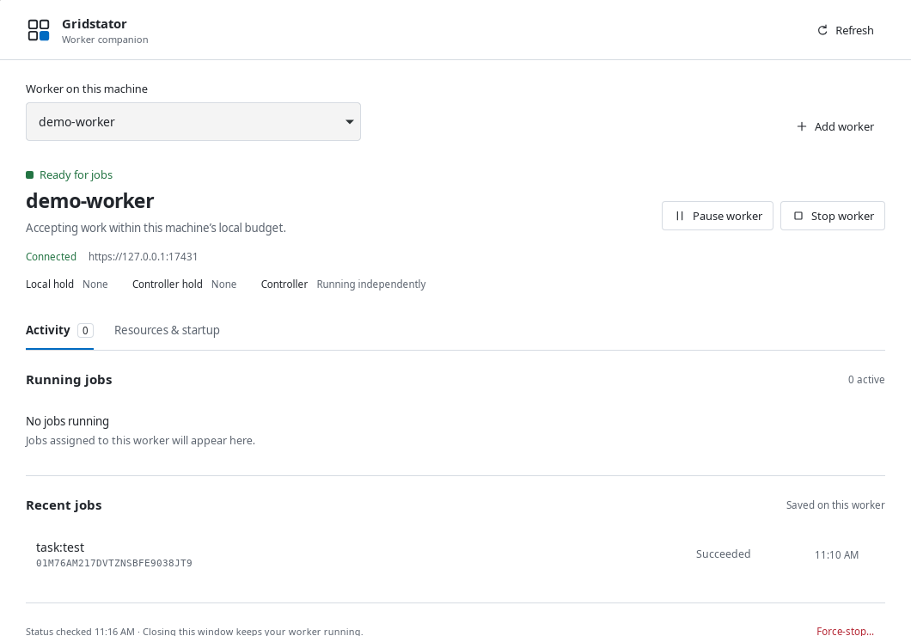
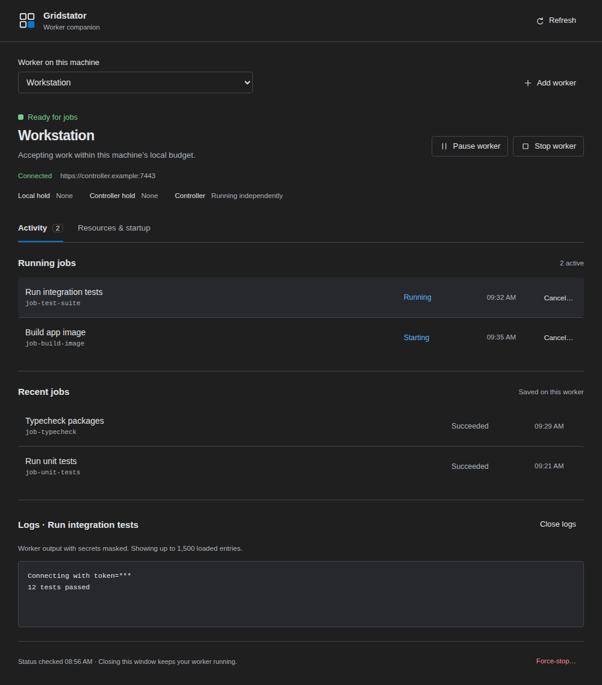

# Product screenshots

The editor and desktop captures are **real application windows** connected to an isolated local Rust controller and Docker worker. The detailed dashboard and launch images are **automated UI fixtures**: they show specific states reproducibly, but do not prove a running cluster or a platform release gate.

| Image | Source and purpose |
| --- | --- |
| [VS Code Run view](images/vscode-editor.png) | Real VS Code 1.145.2 window, native VSIX 2.0.0-dev.2, isolated demo worker, successful `node --test` job from `examples/node-project` |
| [Dashboard overview](images/vscode-dashboard.png) | Playwright webview fixture showing capacity, queue and mixed job states |
| [Workflow launch](images/vscode-run-workflow.png) | Playwright webview fixture showing discovered Actions inputs and worker options |
| [Desktop companion preview](images/desktop-preview-real.png) | Real Linux desktop debug window, isolated demo worker and successful example job; the desktop app is not yet a qualified public release |
| [Desktop activity fixture](images/desktop-preview-fixture.png) | Playwright desktop fixture with multiple active jobs and logs |

## VS Code in context

## Detailed UI states

## Desktop preview

## Capture and refresh

The real editor capture was made from an installed native VSIX in a fresh VS Code profile under Xvfb. The desktop capture used a Linux debug build with disposable desktop settings and startup changes disabled. Both used an isolated v2 controller on loopback, a demo worker and the public example project. The images contain no tokens or private project files. They are visual product evidence only; they do not close Remote SSH, WSL2, Mac or release qualification gates.

To refresh fixture images, run `pnpm test:ui`, inspect the generated images under `apps/vscode/test/ui/screenshots/` and copy only reviewed states into `docs/images/`. The desktop fixture comes from `apps/desktop/test/screenshots/` after `pnpm desktop:test:ui`. These generated test directories are ignored by Git; the curated files here are versioned.

For a new real editor image, package the native VSIX, install it into a **disposable VS Code profile**, point `gridstator.configPath` and `gridstator.nativeCli.path` at an isolated native cluster, open `examples/node-project`, run its test task and capture the full editor window. Review the image at original size before committing: remove tokens, real controller URLs, private host details and notifications. Document the extension/VS Code version and whether the image is a real run or a fixture. Do not relabel a fixture as platform validation.

